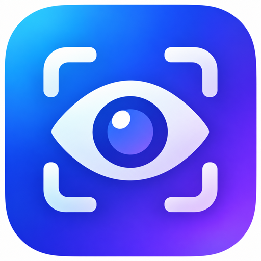

<p align="center">
  
</p>

<p align="center">
  <picture>
    <source media="(prefers-color-scheme: dark)" srcset="https://shieldcn.dev/header/graph.svg?title=applevision&subtitle=Batch+OCR+for+images+and+PDFs+on+macOS&logo=apple&mode=dark" />
    
  </picture>
</p>

<p align="center">
  <a href="https://github.com/thiernoyunus/applevision"></a>
  <a href="https://github.com/thiernoyunus/applevision/commits"></a>
  <a href="https://github.com/thiernoyunus/applevision"></a>
</p>

`applevision` is a macOS command-line tool that batch-processes images and PDFs using Apple's built-in frameworks.

The package now includes:
- `applevision`: the CLI
- `AppleVisionCore`: the shared OCR library
- `AppleVisionApp.xcodeproj`: a native Xcode macOS app project that builds the same app as a standard desktop bundle

It uses:
- `Vision` for OCR via `VNRecognizeTextRequest`
- `PDFKit` for PDF page handling

Structured OCR results now retain:
- per-line text
- top candidate alternatives for OCR lines
- line confidence
- normalized bounding boxes

For PDFs, it prefers embedded selectable text when present and falls back to OCR for scanned pages.

## Build

```bash
swift build
```

## Usage

```bash
swift run applevision [options] <file-or-folder> [more paths...]
```

## macOS App
Open the native Xcode project:

```bash
open /Users/thiernodiallo/Coding/applevision/AppleVisionApp.xcodeproj
```

Then run the `AppleVisionApp` scheme from Xcode for normal macOS app behavior.

The app supports:
- drag-and-drop for files, PDFs, and folders
- output folder selection
- output mode selection: `Both Versions` by default, or `With Harakat` / `Without Harakat`
- export format selection: `Text Files`, `Searchable PDF`, or `Both`
- default Arabic OCR settings
- natural page ordering for filenames such as `1, 2, 3, ... 10, 11`
- a review checkpoint for low-confidence OCR lines before export
- optional reviewed-document translation with either Apple Translation or OpenAI

When text export is included and `Both Versions` is selected, the app writes:
- `*_with_harakat.txt`
- `*_without_harakat.txt`

When searchable PDF export is included, the app also writes:
- `*_searchable.pdf`

If reviewed translation is enabled, the app can also write one extra file such as:
- `*_translated_english.txt`

Translation providers:
- `Apple Translation`: local and free on supported Macs
- `OpenAI`: cloud translation using a user-supplied API key stored in macOS Keychain

The desktop app remembers the last selected translation provider, target language, and OpenAI model between launches.

### Examples

OCR a folder of images and write one combined text file:

```bash
swift run applevision ~/Desktop/scans --output ~/Desktop/scans.txt
```

OCR a mix of images and PDFs:

```bash
swift run applevision ~/Desktop/page1.jpg ~/Desktop/packet.pdf
```

Recurse through subfolders and emit JSON:

```bash
swift run applevision ~/Desktop/archive --recursive --format json --output ~/Desktop/archive.json
```

Write one combined plain-text file without source headers:

```bash
swift run applevision ~/Desktop/scans --plain-text --output ~/Desktop/scans.txt
```

Force OCR for every page in a PDF instead of trusting the PDF's embedded text layer:

```bash
swift run applevision ~/Desktop/book.pdf --pdf-ocr-only --output ~/Desktop/book.txt
```

Specify recognition languages:

```bash
swift run applevision ~/Desktop/scans --languages en-US,fr-FR
```

Write the normal OCR output and a separate verification report:

```bash
swift run applevision ~/Desktop/scans --output ~/Desktop/scans.txt --verification-report ~/Desktop/scans_review.txt
```

## Notes

- This uses Apple's public OCR stack, not a private Live Text API.
- In practice this is the supported way to batch OCR locally on macOS with Apple frameworks.
- The CLI still targets plain text or JSON output.
- The macOS app can now export a searchable PDF that preserves the original page appearance and embeds reviewed text as an invisible search layer.
- `--plain-text` emits only the merged text body, with no per-file separators.
- `--pdf-ocr-only` is useful for PDFs whose embedded text is corrupted, out of order, or unreadable.
- JSON output includes line-level OCR evidence when the source came from Vision OCR.
- `--verification-report` writes a separate human-readable report for suspicious OCR lines and suggested review text.
- The Swift package is now the source of truth for `AppleVisionCore` and the `applevision` CLI only.
- The desktop app is now sourced from `AppleVisionApp.xcodeproj`.
